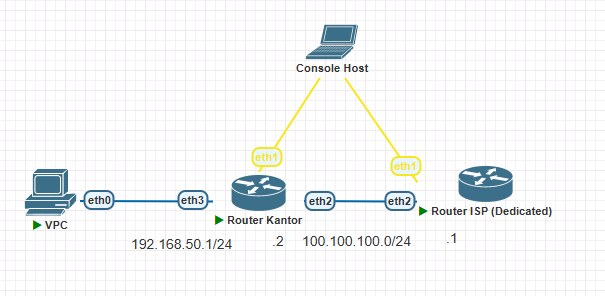
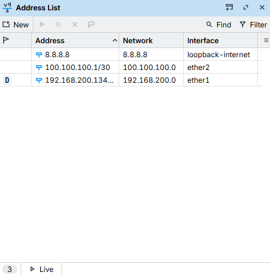
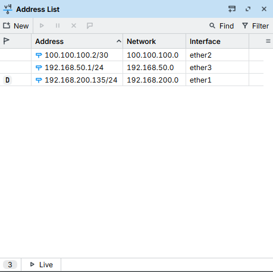
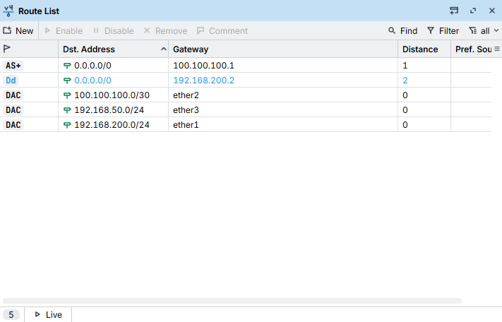
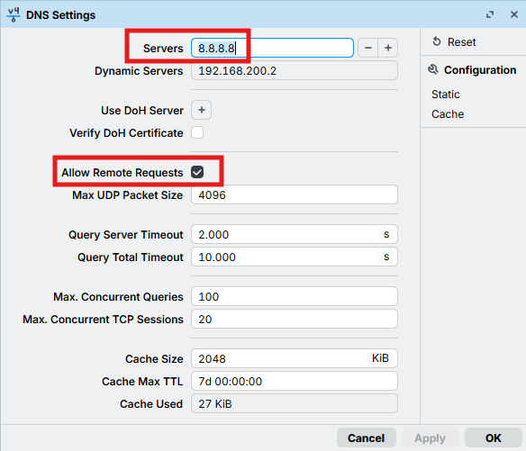
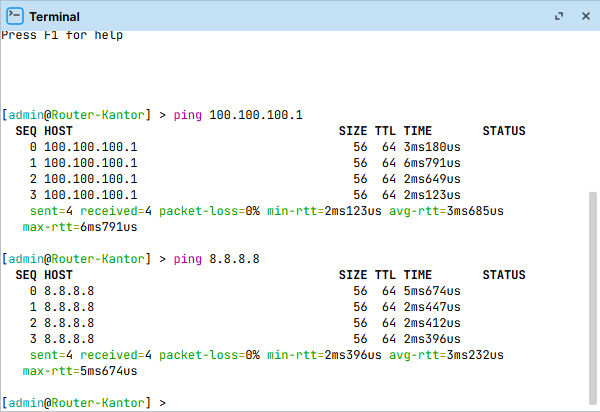
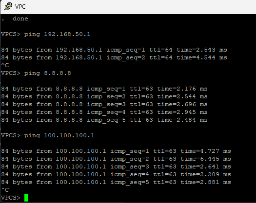

# Konfigurasi Dasar MikroTik RouterOS (Studi Kasus ISP Dedicated / Enterprise)

Dokumentasi praktik laboratorium jaringan komputer menggunakan **PNETLab** dan **Winbox** untuk menerapkan konfigurasi dasar **MikroTik RouterOS** dengan skenario layanan **ISP Dedicated / Enterprise** (IP Public Statis, Default Route Manual, dan DNS Manual).

---

## 1. Topologi Jaringan

### Skema Koneksi Interface
* **`Console Host` (`Cloud0`)** $\leftrightarrow$ **`eth1` Router ISP (Dedicated)**: Jalur khusus *Out-of-Band Management* untuk remote Winbox `Router ISP`.
* **`Console Host` (`Cloud0`)** $\leftrightarrow$ **`eth1` Router Kantor**: Jalur khusus *Out-of-Band Management* untuk remote Winbox `Router Kantor`.
* **`eth2` Router ISP (Dedicated)** $\leftrightarrow$ **`eth2` Router Kantor**: Jalur WAN Dedicated Point-to-Point (`100.100.100.0/24`).
* **`eth3` Router Kantor** $\leftrightarrow$ **`eth0` VPC**: Jalur jaringan lokal (LAN) kantor menuju perangkat klien (`192.168.50.0/24`).

---

## 2. Tabel Pengalamatan IP (IP Addressing)

| Perangkat | Interface | Peran / Koneksi | IP Address | Metode Konfigurasi |
| :--- | :--- | :--- | :--- | :--- |
| **Router ISP (Dedicated)** | `ether1` (`eth1`) | Management (Console Host / Winbox) | `192.168.200.11/24` | Static |
| **Router ISP (Dedicated)** | `ether2` (`eth2`) | Gateway WAN Dedicated | `100.100.100.1/24` | Static |
| **Router ISP (Dedicated)** | `loopback-internet` | Simulasi Target Internet Publik | `8.8.8.8/32` | Static (Bridge Loopback) |
| **Router Kantor** | `ether1` (`eth1`) | Management (Console Host / Winbox) | `192.168.200.12/24` | Static (Tanpa Default Route) |
| **Router Kantor** | `ether2` (`eth2`) | WAN Public Statis (ke Router ISP) | `100.100.100.2/24` | Static Manual |
| **Router Kantor** | `ether3` (`eth3`) | LAN Kantor (ke VPC) | `192.168.50.1/24` | Static + DHCP Server |
| **VPC** | `eth0` | End-User Client | `192.168.50.x/24` | DHCP Client (`ip dhcp`) |

---

## 3. Tahapan Konfigurasi `Router ISP (Dedicated)`

`Router ISP (Dedicated)` berperan sebagai penyedia layanan internet enterprise yang memberikan blok IP Public statis dan mensimulasikan server target internet (`8.8.8.8/32`).

### A. Konfigurasi IP Address & Bridge Loopback
1. **Management (`ether1`):** `192.168.200.11/24` (akses remote Winbox).
2. **Gateway WAN (`ether2`):** `100.100.100.1/24` (mengarah ke `Router Kantor`).
3. **Simulasi Internet (`loopback-internet`):** Membuat interface *Bridge* bernama `loopback-internet` dan memasang IP `8.8.8.8/32`.

---

## 4. Tahapan Konfigurasi `Router Kantor` (Studi Kasus Utama)

Karena menggunakan layanan **ISP Dedicated / Enterprise**, konfigurasi WAN pada `Router Kantor` dilakukan sepenuhnya secara **manual** tanpa menggunakan DHCP Client pada interface WAN (`ether2`).

### A. Konfigurasi IP Address Public & LAN (`IP` $\rightarrow$ `Addresses`)
* **`ether1` (Management):** `192.168.200.12/24`
* **`ether2` (WAN Public Manual):** `100.100.100.2/24`
* **`ether3` (LAN Lokal):** `192.168.50.1/24`

### B. Konfigurasi Default Route Manual (`IP` $\rightarrow$ `Routes`)
Mengarahkan seluruh trafik menuju internet melewati Gateway IP Public milik ISP:
* **Dst. Address:** `0.0.0.0/0`
* **Gateway:** `100.100.100.1` (Status aktif **AS** — *Active, Static*)

### C. Konfigurasi DNS Server Manual (`IP` $\rightarrow$ `DNS`)
Memasukkan alamat server DNS secara manual agar router dan klien dapat menerjemahkan nama domain:
* **Servers:** `8.8.8.8`
* **Allow Remote Requests:** Dicentang (`yes`)

### D. Konfigurasi DHCP Server & Firewall NAT (`Masquerade`)
1. **DHCP Server (`ether3`):** Dijalankan melalui wizard `DHCP Setup` pada interface `ether3` untuk membagikan IP otomatis rentang `192.168.50.2-192.168.50.254` ke klien.
2. **Firewall NAT (`IP` $\rightarrow$ `Firewall` $\rightarrow$ `NAT`):**
   * **Chain:** `srcnat` | **Out. Interface:** `ether2` | **Action:** `masquerade`

---

## 5. Pengujian & Verifikasi

### A. Pengujian Konektivitas dari Terminal `Router Kantor`
Melakukan uji *ping* dari **New Terminal** Winbox `Router Kantor` menuju Gateway ISP (`100.100.100.1`) dan simulasi server internet (`8.8.8.8`):

### B. Pengujian Konektivitas dari Sisi Klien (`VPC`)
Meminta IP otomatis melalui perintah `ip dhcp` pada konsol **VPC**, kemudian menguji koneksi ke seluruh titik jaringan:
1. `ping 192.168.50.1` $\rightarrow$ Koneksi ke Gateway LAN `Router Kantor` (**Berhasil**).
2. `ping 100.100.100.1` $\rightarrow$ Koneksi melintasi WAN menuju Gateway `Router ISP` (**Berhasil**).
3. `ping 8.8.8.8` $\rightarrow$ Koneksi menuju jaringan publik melalui translasi NAT (**Berhasil**).

---

## 6. Catatan Troubleshooting Selama Praktikum

* **Konflik Dual Default Route (`DAd` vs `AS+`):**
  * *Masalah:* Saat pertama kali menguji `ping 8.8.8.8` dari `Router Kantor`, paket berhasil mencapai `100.100.100.1` tetapi gagal mencapai `8.8.8.8` karena masih terdapat rute default dinamis (`DAd 0.0.0.0/0 -> 192.168.200.2`) dari DHCP Client jalur manajemen `ether1` yang memiliki `Distance = 1` sama seperti rute statis.
  * *Solusi:* Menonaktifkan opsi `Add Default Route` (mengubah ke `no`) pada DHCP Client `ether1` sehingga rute statis `AS 0.0.0.0/0 -> 100.100.100.1` menjadi satu-satunya jalur keluar utama yang aktif.
